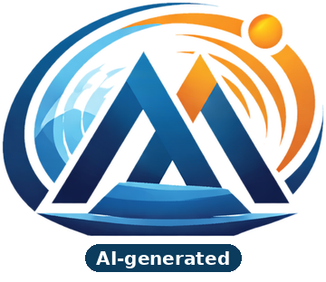
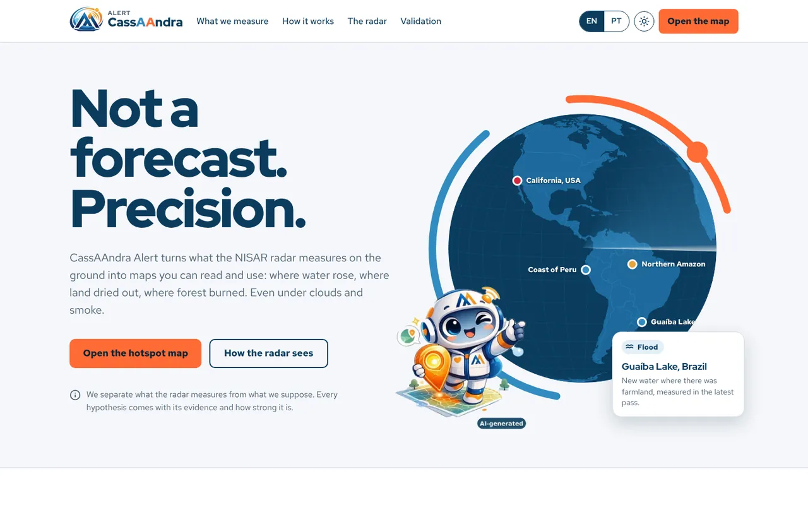
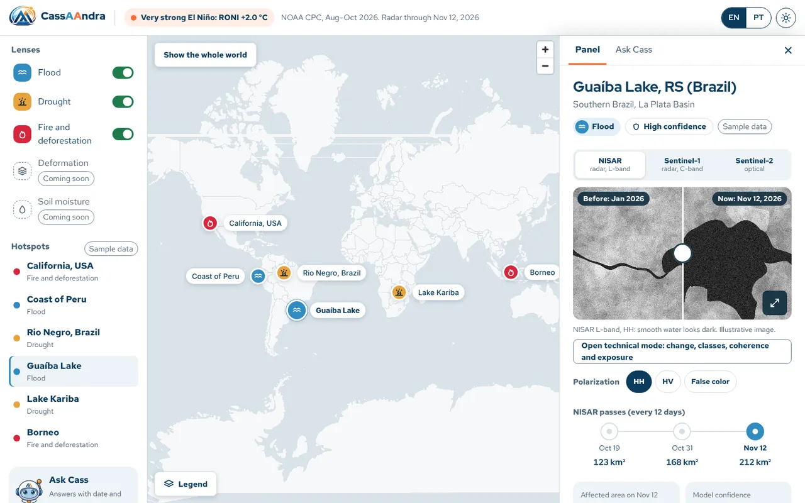
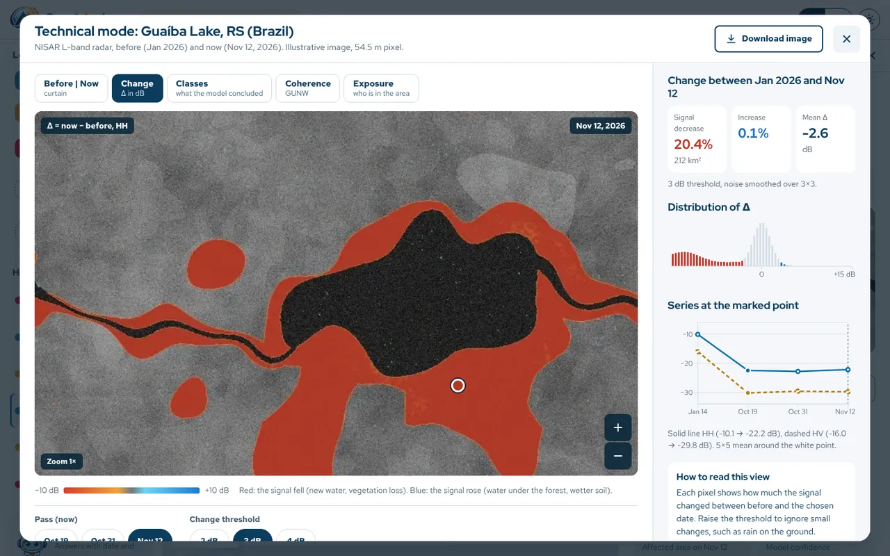
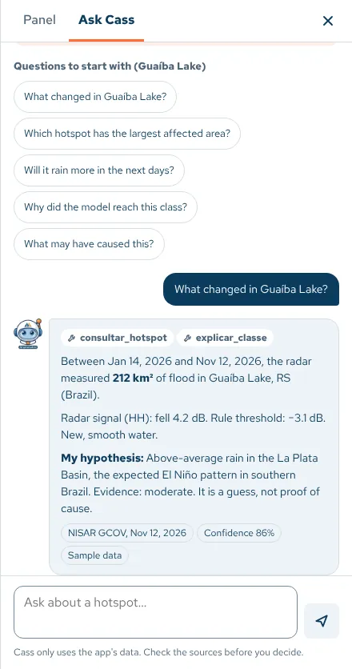
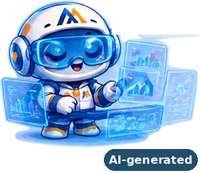
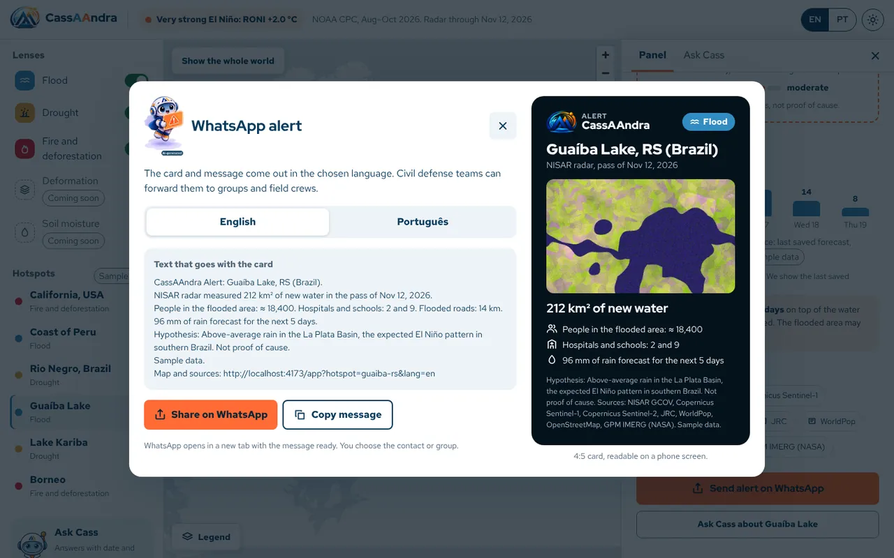
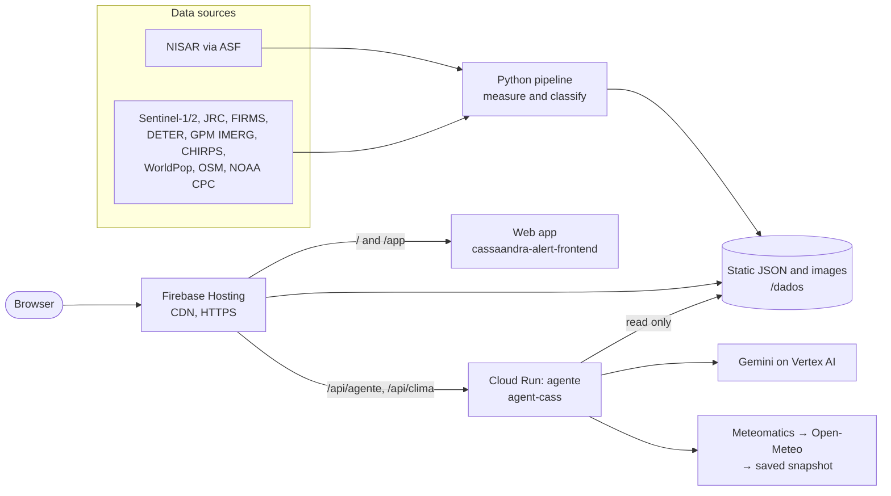
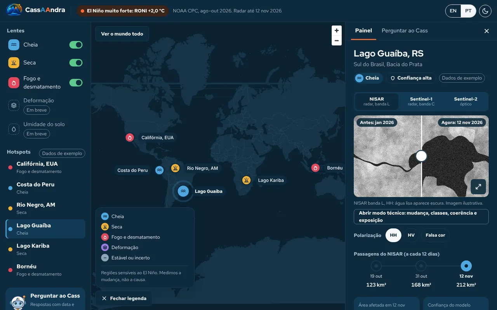
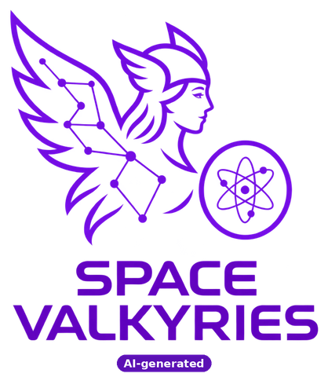

  <picture>
    <source media="(prefers-color-scheme: dark)" srcset="docs/images/cassaandra-symbol-dark.png" />
    
  </picture>

<h1 align="center">CassAAndra Alert</h1>

<strong>Not a forecast. Precision.</strong>

  Floods, droughts and burned areas measured by radar, even under clouds and smoke. 
  Built by team <strong>Space Valkyries</strong> for the <strong>NASA Space Apps Challenge 2026</strong>,
  challenge <a href="https://www.spaceappschallenge.org/2026/challenges/dancing-with-the-sars/"><em>Dancing with the SARs</em></a>.

  <a href="https://cassaandra-alert.web.app"><strong>Open the app →</strong></a> ·
  <a href="https://cassaandra-alert.web.app/app">Map</a> ·
  <a href="https://cassaandra-alert.web.app/?lang=pt">Versão em português</a>

> **Sample data.** The radar pipeline is still publishing its first real results. Until then, the numbers and images in the app are illustrative samples, and the app and Cass say so on screen.

## Repositories

| Repository                                                                            | What it is                                                                             | Stack                                                           |
| ------------------------------------------------------------------------------------- | -------------------------------------------------------------------------------------- | --------------------------------------------------------------- |
| **[cassaandra-alert](https://github.com/Montezi/cassaandra-alert)** (this one)        | Project overview: problem, method, architecture and team                               | —                                                               |
| **[cassaandra-alert-frontend](https://github.com/Montezi/cassaandra-alert-frontend)** | The web app: landing page, map, hotspot panel, technical mode, chat and WhatsApp alert | Vite, React, TypeScript, MapLibre, Firebase Hosting             |
| **[agent-cass](https://github.com/Montezi/agent-cass)**                               | Cass, the chat agent, and the rain forecast API (`/api/agente`, `/api/clima`)          | Python, FastAPI, Strands Agents, Gemini on Vertex AI, Cloud Run |

## The problem

El Niño 2026 is very strong: the RONI index reached **+2.0 °C** in Aug–Oct (NOAA CPC). It brings floods to some regions and drought and fire to others. These events happen under heavy clouds and smoke, exactly when optical satellites cannot see the ground. Civil defense teams need to know **where** the water rose or the forest burned, not a forecast of what might happen.

In May 2024 we watched the Guaíba rise higher than ever recorded and Porto Alegre go under water. That is why Guaíba Lake is the first place Cass watches. But radar has no borders: the same method measures fire in California and drought in southern Africa.

## Our solution

CassAAndra Alert turns what the **NISAR** radar (NASA and ISRO, L-band) measures on the ground into maps anyone can read:

- **A global map of hotspots** sensitive to El Niño, each with the class the radar measured: flood, drought, or fire and deforestation.
- **Before and now images** from three sensors (NISAR L-band, Sentinel-1 C-band, Sentinel-2 optical), with the area affected in each NISAR pass, every 12 days.
- **Measured × Hypothesis.** What the radar measured always comes with source and date. A possible cause is a hypothesis, shown apart, with its evidence and how strong it is. We never say El Niño caused a change: we measure the change, not the cause.
- **Who is in the affected area**, from WorldPop and OpenStreetMap.
- **Cass**, an agent that answers questions only with measured data, in English and Portuguese.
- **A WhatsApp alert** that civil defense teams can forward, with the measured area, the people exposed and the rain forecast.

## How it works

### How radar sees through clouds

- **L-band, long waves.** NISAR's wave is about 24 cm long. It goes through cloud, rain and smoke, day and night.
- **HH polarization finds water.** Smooth water reflects the pulse away from the satellite and looks dark. Flooded forest does the opposite: the wave bounces between water and trunks (double bounce) and the area looks brighter.
- **HV polarization finds vegetation.** The wave leaves horizontal and comes back vertical when it hits branches and leaves. If the forest burns or is cleared, that echo drops.
- **Coherence finds what changed.** Comparing the phase of two passes shows what stayed the same and what did not.

### From satellite to alert in five steps

1. **Search.** Find the NISAR passes before (early 2026) and now over each hotspot (ASF, `asf_search`, `earthaccess`).
2. **Crop.** Download only the hotspot area, not the whole multi-GB file.
3. **Measure.** Smooth the speckle (3×3), compute the change in backscatter in dB for HH and HV, the coherence and the accumulated rain.
4. **Classify.** An explainable decision tree labels each cell as flood, drought, fire, deformation or stable, with change thresholds of 2, 3 or 4 dB. Every rule is shown in the app.
5. **Explain.** Cass separates what was measured from the hypothesis about the cause, always with date and source.

<table>
  <tr>
    <td width="68%"></td>
    <td></td>
  </tr>
  <tr>
    <td>Technical mode: change in dB, classes, coherence and exposure</td>
    <td>Ask Cass</td>
  </tr>
</table>

### How we validate

We compare the classifier's result, cell by cell, with independent reference data that the model does not use to decide. The metrics are precision and F1 per reference.

| Reference                | What it checks      | How we compare                                                                                 |
| ------------------------ | ------------------- | ---------------------------------------------------------------------------------------------- |
| JRC Global Surface Water | Flood and drought   | New water must lie outside JRC permanent water; water that receded must have been water in JRC |
| Copernicus Sentinel-1    | Flood in open areas | The same flooded area seen by another radar (C-band), on a date close to the NISAR pass        |
| DETER (INPE)             | Deforestation       | INPE deforestation alerts in the same area, between the two passes                             |
| FIRMS (NASA)             | Active fires        | NASA heat spots on the dates between the before and now images                                 |

## Meet Cass

  
  
  

Cass is the mascot and the chat agent. It answers only with what the radar and the tools measured:

- every number comes from a tool result, and a final check compares the answer with them;
- every answer cites its sources and dates;
- a possible cause is always labelled as a hypothesis, with its strength;
- it refuses questions outside its scope and resists prompt injection.

Cass runs on [Strands Agents](https://strandsagents.com) with Gemini on Vertex AI. Details in [agent-cass](https://github.com/Montezi/agent-cass).

## Hotspots

| Hotspot                                    | El Niño effect              | Class                  |
| ------------------------------------------ | --------------------------- | ---------------------- |
| Norte Fire, San Clemente, California (USA) | wetter winter               | Fire and deforestation |
| Piura, northern coast of Peru              | coastal El Niño, heavy rain | Flood                  |
| Rio Negro, Amazonas (Brazil)               | drought                     | Drought                |
| Guaíba Lake, RS (Brazil)                   | above-average rainfall      | Flood                  |
| Lake Kariba, Zambia and Zimbabwe           | drier until March           | Drought                |
| Central Kalimantan, Borneo                 | drought and peatland fires  | Fire and deforestation |

## Architecture

- **Static first.** The pipeline computes everything ahead of time and publishes static files. The app loads fast on slow 4G and needs no database.
- **One origin.** Firebase Hosting serves the app and the data, and forwards `/api/*` to Cloud Run. The browser needs no CORS and never sees an API key.
- **Contracts between the parts.** The data contract (`/dados`) and the API contract (`/api/*`) are documented in both code repositories and validated on both sides (zod in the app, Pydantic in the agent).
- **Graceful fallbacks.** If the forecast API is down, the app shows the last saved forecast with its date. If the agent is unavailable, the chat switches to a clearly marked demo mode built from the same data, without AI.
- **No stored keys.** Gemini runs with a service account, the Meteomatics credentials live in Secret Manager, and GitHub deploys through Workload Identity Federation.

## Data sources

- **NASA:** NISAR (NASA and ISRO, via ASF), GPM IMERG, FIRMS
- **NOAA:** CPC, RONI index
- **Copernicus:** Sentinel-1, Sentinel-2
- **Other:** ESA WorldCover, JRC Global Surface Water, DETER/INPE, CHIRPS, WorldPop, OpenStreetMap, Meteomatics, Open-Meteo
- **Basemap:** OpenFreeMap and OpenStreetMap contributors

## Accessibility and languages

- English by default, Portuguese with one click. The language stays in shared links.
- Light and dark themes, WCAG AA contrast in both.
- Every class has an icon and a name, not just a color, and every hotspot is also listed as text next to the map.
- Keyboard navigation, visible focus and reduced motion respected.

  

> Screenshots show sample data. The basemap in them is a simplified stand-in; the live app uses OpenFreeMap with place names in the chosen language.

## Team

  
  &nbsp;&nbsp;&nbsp;
  

**Space Valkyries:** Ana, Aline and Mirian.

The CassAAndra symbol has two A's, for Ana and Aline. Where they cross, they form the M of Mirian. Around them, the radar's orbit sweeps the planet.

## Use of AI

We used AI tools to speed up the project, and we mark every use:

| What                                                                     | How AI was used                                                                             | How it is marked                                                                                            |
| ------------------------------------------------------------------------ | ------------------------------------------------------------------------------------------- | ----------------------------------------------------------------------------------------------------------- |
| **Cass images**                                                          | AI-generated                                                                                | Visible "AI-generated" label on every image                                                                 |
| **CassAAndra symbol and Space Valkyries logo**                           | AI-generated                                                                                | "AI-generated" label in this README and under the big symbol in the app; listed in the app's **AI credits** |
| **Illustrative radar images** (before/now, technical layers, alert card) | Synthetic images made by code written with AI assistance                                    | Visible "AI-generated" label in the app                                                                     |
| **Sample data** in `/dados`                                              | Put together with AI assistance until the pipeline publishes real results                   | `"ai_generated": true` and `"sample": true` in each file's `metadata`; "Sample data" badge in the app       |
| **Code and docs**                                                        | Developed with AI coding assistants (Claude); the team reviewed and approved each change    | This section, the repositories' READMEs, and a `Co-Authored-By` trailer on assisted commits                 |
| **Cass's answers**                                                       | Gemini on Vertex AI writes the answers, limited to measured data, with every number checked | Described in the app and in [agent-cass](https://github.com/Montezi/agent-cass)                             |

The app's header and the landing page footer link to an **AI credits** dialog with this list. No AI-generated content uses NASA logos, flags or mission identifiers.

This is a team project for the NASA Space Apps Challenge. It is not affiliated with or endorsed by NASA.

## License

The code repositories are released under the [MIT License](https://github.com/Montezi/cassaandra-alert-frontend/blob/main/LICENSE). Data sources keep their own licenses and terms.
